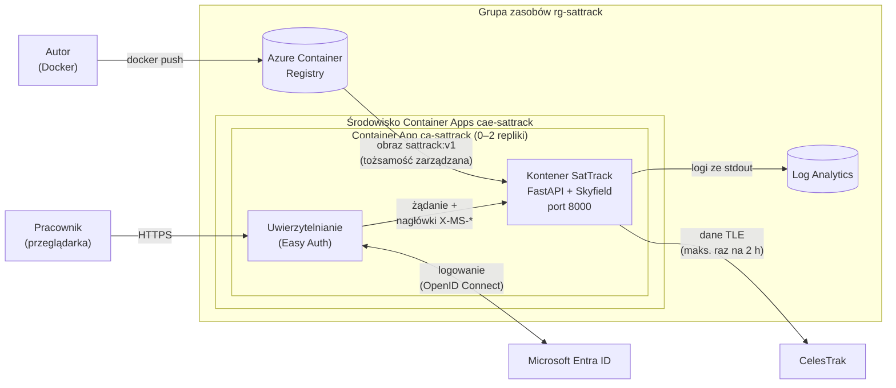

# Architektura SatTrack

SatTrack to wewnętrzna aplikacja webowa firmy geodezyjnej. Działa w **Azure Container Apps**, a dostęp do niej mają tylko pracownicy zalogowani kontem organizacji (**Microsoft Entra ID**).

## Diagram

## Komponenty

**Przeglądarka użytkownika.** Pracownik otwiera adres `https://ca-sattrack.<...>.azurecontainerapps.io`. Frontend (HTML, CSS i JavaScript) pobiera z internetu tylko kafelki mapy OpenStreetMap oraz biblioteki Leaflet i Chart.js z CDN. Wszystkie dane o satelitach pochodzą z API aplikacji.

**Microsoft Entra ID.** Katalog kont organizacji. Niezalogowany użytkownik jest przekierowywany (HTTP 302) na stronę logowania Microsoft i wraca do aplikacji dopiero po zalogowaniu. Platforma korzysta z rejestracji aplikacji (App registration) utworzonej podczas konfiguracji uwierzytelniania.

**Azure Container Apps** to bezserwerowa usługa kontenerów w planie Consumption. Składa się z dwóch warstw:
- **Środowisko** (`cae-sattrack`) to wspólna granica sieciowa i logowania dla aplikacji.
- **Aplikacja** (`ca-sattrack`) ma publiczny ingress HTTPS z certyfikatem zapewnianym przez platformę, przyjmuje ruch na porcie 8000 i dostaje 0,25 vCPU oraz 0,5 GiB RAM. Liczba replik zmienia się od 0 do 2: bez ruchu aplikacja skaluje się do zera i nic nie kosztuje.
- **Uwierzytelnianie (Easy Auth)** działa przed kontenerem: odrzuca niezalogowane żądania, a zalogowanym dokleja nagłówki `X-MS-CLIENT-PRINCIPAL-NAME` i `X-MS-CLIENT-PRINCIPAL`. Klient z zewnątrz nie może tych nagłówków podrobić.

**Kontener SatTrack.** Obraz `python:3.12-slim`, uruchamiany jako użytkownik bez uprawnień roota. Składa się z kilku modułów:
- **FastAPI** udostępnia API JSON (`/api/...`), frontend (`/`), sondę zdrowia (`/healthz`) i dokumentację API (`/docs`),
- **Skyfield** (model SGP4) liczy pozycje satelitów, ich widoczność z punktu na Ziemi (elewacja i azymut), liczbę widocznych satelitów w ciągu 24 h oraz przeloty ISS,
- **`tle_store`** przechowuje dane orbitalne (TLE) i bierze je z kolejnych źródeł: pamięć (ważna 2 h) → CelesTrak → plik w katalogu cache → snapshot w obrazie. Dzięki snapshotowi aplikacja działa nawet po zimnym starcie bez dostępu do CelesTrak.

**CelesTrak** (celestrak.org) to publiczne, darmowe źródło danych orbitalnych. Aplikacja pobiera z niego 5 grup: GPS, Galileo, GLONASS, BeiDou i stacje kosmiczne. Każdą grupę pobiera najwyżej raz na 2 h, bez ponawiania po błędzie, zgodnie z zasadami serwisu.

**Azure Container Registry** (`acrsattrack<sufiks>`, SKU Basic) to prywatne repozytorium obrazów. Container App pobiera z niego obraz przy użyciu **tożsamości zarządzanej** (rola `AcrPull`), więc nie ma tu haseł ani sekretów.

**Log Analytics** to obszar roboczy tworzony razem ze środowiskiem Container Apps. Trafia do niego wszystko, co kontener wypisuje na stdout (tabela `ContainerAppConsoleLogs_CL`): start aplikacji, źródło danych TLE, pobrania z CelesTrak i czas obliczeń. Logi można przeszukiwać językiem zapytań KQL.

## Przepływ żądania

1. Użytkownik otwiera adres aplikacji. Easy Auth nie widzi sesji, więc przekierowuje go do logowania w Entra ID.
2. Po zalogowaniu Easy Auth zakłada sesję w ciasteczku i przekazuje żądanie do kontenera, doklejając nagłówki z tożsamością użytkownika.
3. Jeśli aplikacja była przeskalowana do zera, Container Apps uruchamia replikę (zimny start trwa kilka sekund).
4. Frontend odpytuje API, np. `/api/visible?lat=50.30&lon=18.95`. FastAPI liczy wynik w Skyfield na danych z `tle_store` i zwraca JSON.
5. Pasek górny wyświetla nazwę użytkownika z `/api/me`, a „Wyloguj” prowadzi do `/.auth/logout`, które obsługuje platforma.

## API

| Ścieżka | Opis |
|---|---|
| `GET /` | Frontend |
| `GET /healthz` | Sonda zdrowia: `{"status": "ok"}` |
| `GET /api/me` | Zalogowany użytkownik albo tryb lokalny |
| `GET /api/groups` | Grupy satelitów, źródło i wiek danych TLE |
| `GET /api/satellites?group=gps` | Aktualne pozycje satelitów w grupie |
| `GET /api/satellites/{norad_id}` | Szczegóły satelity i ślad orbity ±45 min |
| `GET /api/visible?lat=&lon=` | Widoczne satelity GNSS w punkcie |
| `GET /api/visibility-timeline?lat=&lon=` | Liczba widocznych satelitów w ciągu 24 h |
| `GET /api/passes/{norad_id}?lat=&lon=` | Przeloty nad punktem w ciągu 48 h |
| `GET /docs` | Interaktywna dokumentacja API (Swagger UI) |
